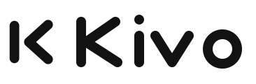
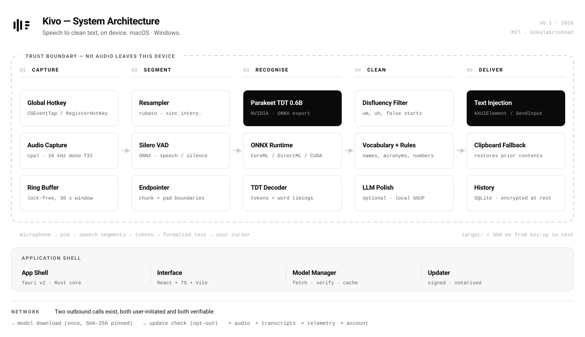

<div align="center">



### Turns voice into clean text

Hold a key. Speak. Clean, punctuated text appears at your cursor — in any app,<br>
on macOS and Windows, entirely on your own machine.

<br>

[](https://github.com/Gokulakrishnxn/Kivo/actions/workflows/ci.yml)
[](https://github.com/Gokulakrishnxn/Kivo/actions/workflows/codeql.yml)
[](LICENSE)
[](#)
[](SECURITY.md)

**[Website](https://gokulakrishnxn.github.io/Kivo/)** ·
**[PRD](PRD.md)** ·
**[Architecture](docs/ARCHITECTURE.md)** ·
**[Brand kit](brand/BRAND.md)** ·
**[Contributing](CONTRIBUTING.md)**

</div>

---

> [!NOTE]
> **Kivo is at Milestone 0.** The product definition, architecture, brand system and
> website are done. The application itself is being built — see
> [the milestone plan](PRD.md) for what lands when, and
> [CONTRIBUTING.md](CONTRIBUTING.md) if you would like to help.

## Why

People speak at about 150 words per minute and type at 40 to 60. Dictation should have
replaced the keyboard years ago. It has not, for three reasons:

- **The output needs editing.** Raw transcription gives you an unpunctuated wall of text
  with every "um" faithfully preserved. Cleaning it up costs back the time you saved.
- **It does not live where you work.** It is stuck in one app, or behind a web page you
  have to copy out of.
- **It is a privacy trade.** The accurate options stream your microphone to a server and
  charge you monthly. If you handle client work, medical notes, legal drafts or
  unreleased code, that is not a trade you are allowed to make.

Kivo fixes all three. The third one only became fixable recently: on-device speech
models are now fast and accurate enough that the cloud is no longer the price of quality.

## What it does

```
  hold your key  ──▶  speak  ──▶  release
                                     │
                                     ▼   under 300 ms
             clean text, at your cursor, in the app you were already using
```

**Clean is the whole product.** Given this, spoken aloud:

> "um so i think we should uh push the release to friday — no wait, thursday — because
> the uh the QA cycle needs two full days"

Kivo types this:

> I think we should push the release to Thursday, because the QA cycle needs two full days.

Fillers gone, stutter collapsed, self-correction resolved, throat-clearing dropped.
No editing pass.

## Features

|  |  |
|---|---|
| ⌨️ **One global hotkey** | Works in every app, including full-screen. Push-to-talk or latched. |
| ✍️ **Inserts at the cursor** | Straight into Slack, VS Code, Word, your browser. Single undo. |
| 🧹 **Cleans as it goes** | Punctuation, capitalisation, fillers, stutters, your own vocabulary. |
| 🎚️ **Modes** | Standard, message, email, notes, code — and raw, when you want exactly what you said. |
| 🔒 **On-device** | Audio never leaves your machine and is never written to disk. |
| 🚫 **No account** | Nothing to sign up for. No telemetry. No subscription. |
| 🖥️ **macOS and Windows** | Native on both, with the same behaviour. |
| 📖 **Open source** | MIT licensed. Read it, fork it, ship it. |

## How it works

<p align="center">
  <picture>
    <source media="(prefers-color-scheme: dark)" srcset="docs/diagrams/architecture-dark.svg">
    
  </picture>
</p>

Five stages, one process, no network:

1. **Capture** — a global hotkey opens the microphone into a lock-free ring buffer.
2. **Segment** — resample to 16 kHz, then Silero VAD trims the dead air around your speech.
3. **Recognise** — **NVIDIA Parakeet TDT 0.6B** runs through ONNX Runtime on the Neural
   Engine, CUDA, DirectML or CPU. It returns punctuation, capitalisation and word timings.
4. **Clean** — deterministic rules remove fillers and stutters; an optional local LLM
   pass handles self-corrections and register.
5. **Deliver** — text is inserted through the accessibility layer, falling back to a
   clipboard paste that restores what was there before.

[Read the architecture in full →](docs/ARCHITECTURE.md)

### Stack

| | |
|---|---|
| **Shell** | Tauri v2 — Rust core, ~10 MB binary, well under 150 MB resident |
| **Interface** | React 19 · TypeScript · Vite · Tailwind CSS v4 · Radix UI |
| **Speech** | NVIDIA Parakeet TDT 0.6B (CC-BY-4.0) via ONNX Runtime + sherpa-onnx |
| **Audio** | `cpal` capture · `rubato` resampling · Silero VAD |
| **Cleanup** | Rust rule engine · optional `llama.cpp` for the local polish pass |
| **Storage** | SQLite, encrypted at rest, key in the OS keychain |

Why Parakeet: it emits punctuation, capitalisation and word-level timestamps natively,
its token-and-duration decoder skips frames instead of stepping every one — which is
what makes a sub-300 ms budget realistic — and CC-BY-4.0 permits commercial
redistribution, which most competitive open speech weights do not.
[The full reasoning, and what we will do if it misses its budget →](PRD.md)

## Privacy

Kivo makes nine specific, checkable promises. Among them:

- Audio never leaves the device, and is never written to disk
- Transcripts never leave the device
- No telemetry, no analytics, no crash reporting
- The only outbound requests are the model download and an opt-out update check
- The microphone opens on key-down and closes on key-up, so the OS indicator is honest
- Your clipboard is restored after the paste fallback

Settings shows a live network panel. Its normal state is empty. **A demonstrated
violation of any of these is a security vulnerability** — see [SECURITY.md](SECURITY.md).

## Getting started

Kivo is not yet released. To follow along, watch the repository or read the
[milestone plan](PRD.md).

To work on the website or the brand system today:

```bash
git clone https://github.com/Gokulakrishnxn/Kivo.git
cd Kivo
python3 -m http.server 8000 --directory web
```

Then open <http://localhost:8000> — the brand kit is at `/brand.html`. No toolchain
required.

## Roadmap

| | Milestone | Status |
|---|---|---|
| **M0** | Foundation — PRD, architecture, brand, website, CI | ✅ Done |
| **M1** | Spike — Parakeet to ONNX, latency and accuracy measured on both platforms | ⏳ Next |
| **M2** | Walking skeleton — hotkey → speech → text, macOS | ○ |
| **M3** | Windows parity | ○ |
| **M4** | Cleanup engine, modes, vocabulary | ○ |
| **M5** | Onboarding, settings, overlay, history | ○ |
| **M6** | Signing, notarisation, updater, app test matrix | ○ |
| **M7** | v1.0 | ○ |

## Design

Kivo looks like **a storybook spread on cream parchment**. The chrome is deliberately
quiet — warm paper, hairline borders, no shadows — so a small cast of hand-drawn
characters and a scatter of punctuation confetti can carry the personality.

The mark is the product's thesis in six rectangles: three waveform bars in sky, sun and
ember resolving into three lines of settled charcoal text. What you say arrives loud and
messy; what Kivo hands back is calm.

<p align="center">
  
</p>

<p align="center">
  
  
  
  
  
</p>

One rule governs the rest: **the illustrations are playful, the claims are not.** A
storybook look does not license a storybook promise.

[Brand guidelines](brand/BRAND.md) · [Design tokens](brand/tokens/kivo-tokens.css) ·
[Interactive brand kit](web/brand.html)

## Contributing

Contributions are welcome, including your first one. Docs, bug reports, accuracy
reports, design work and testing on hardware nobody here owns are all genuinely useful.

Start with [CONTRIBUTING.md](CONTRIBUTING.md), and note the
[privacy rules for contributors](CONTRIBUTING.md) — never attach real audio,
transcripts or unredacted screenshots to an issue or a pull request.

Everyone taking part follows the [Code of Conduct](CODE_OF_CONDUCT.md).

## Licence

**Code: [MIT](LICENSE) © 2026 Gokulakrishnan.** Fork it, modify it, ship it, sell it.

**Brand: not covered by the MIT licence.** The Kivo name and the assets in `brand/`
belong to the copyright holder. You may use them to refer to this project; you may not
use them as the identity of your own fork or product. If you fork Kivo, please give it
your own name and mark. Full terms in [NOTICE](NOTICE).

---

<div align="center">
<sub>Built by <a href="https://github.com/Gokulakrishnxn">Gokulakrishnan</a>.<br>
100% open source. No account, no subscription, no audio leaving your machine.</sub>
</div>
